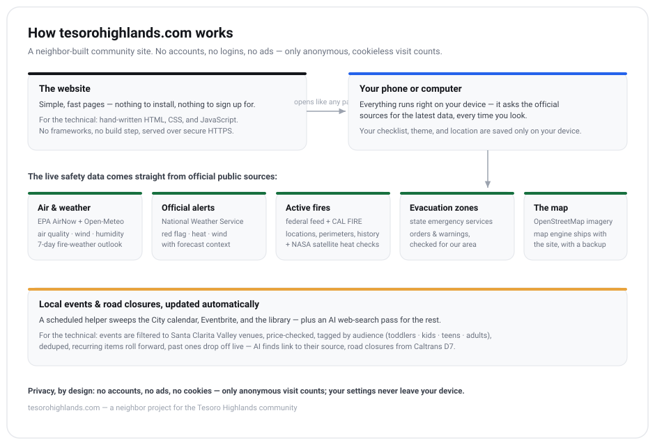

# Tesoro Highlands — Community Hub

A neighbor-built hub for **Tesoro Highlands, Valencia CA 91354**, living at
**[tesorohighlands.com](https://tesorohighlands.com)**.

It answers the questions a household in wildfire country actually asks — *what's
burning near us, what are we breathing, do we need to get ready to leave* — and grows
from there into the everyday stuff: local events, practical living info, and plain
English about your rights as a California homeowner.

**Not official.** This isn't the HOA and isn't an emergency-warning system. Always
follow CAL FIRE, LA County Fire, and Sheriff evacuation orders, and call 911 in an
emergency.

*Last reviewed: 2026-09-02. If you change a workflow cadence, a data source, or a cost
figure, please update this file in the same commit.*

## Want to help?

See **[CONTRIBUTING.md](CONTRIBUTING.md)**. Short version: fork it, open a pull
request, no special access needed. There are rules in there that aren't obvious —
worth a skim before touching the fire logic.

## Fork it for your own neighborhood

That's an explicit goal. It's plain HTML, CSS and JavaScript with no build step, so
you can read the whole thing. The pieces you'd change are the coordinates in
`fire.html` / `nav.js`, the local phone numbers in `living.html`, and the event
sources in `scripts/fetch-events.mjs`. Apache-2.0 licensed, so go ahead — just note
the license asks you to mark files you've changed, and please don't imply your fork
is this site.

## How it's built



*(Live copy: [tesorohighlands.com/stack.svg](https://tesorohighlands.com/stack.svg))*

Plain HTML/CSS/JS. No framework, no build step, no bundler. **Four** Vercel serverless
route handlers under `api/` (`calfire`, `purpleair`, `tempest`, `tempest-forecast`), plus
shared `api/_epa.js` (not a route). Data refreshes come from scheduled GitHub Actions
that commit JSON back to the repo, which redeploys the site. Everything a visitor's
browser fetches is either a static file, a proxied government API, or one of those
functions (some need repo secrets on Vercel).

## Pages

```
/            hub — live "right now" status, alert chips, what's coming up,
             live one-liners per section, "new on this site" changelog
/fire        the dashboard — nearby fires (CAL FIRE acreage/containment + NASA VIIRS
             satellite heat), measured air quality, fire weather, NWS alerts, 7-day
             outlook, Leaflet fire/evac map, evacuation status + routes + go-bag
             checklist, road closures, power outages, earthquakes
/weather     backyard weather — Tempest + PurpleAir now readings, EPA-corrected AQI
             with 24h sparkline, hourly and 10-day Better Forecast (labeled model,
             not measured); links back to Fire for emergency context
/events      community events + auto-built local feed + AI-found extras (merged into
             one list) + the Friday AI weekend roundup with Copy-for-WhatsApp
/living      utilities, trash, schools, health, fire-zone insurance, amenities,
             neighbor-recommended local pros
/hoa         CA homeowner rights, your documents, the dispute ladder
             (deliberately no board schedules or internal community matters)
/business    neighbor-owned businesses: owners submit a form, the site owner approves.
             Hidden until it launches: unlinked, out of the sitemap, noindex
/treats      Halloween treat map for the houses behind the gate: neighbors-only
             (needs the code), not in the nav, noindex (see "Halloween treat map")
```

## Project layout

```
index.html weather.html fire.html events.html living.html hoa.html 404.html
th.css                the only stylesheet — design tokens (light/dark) + shell
theme.js              theme boot, runs before first paint so there's no flash
nav.js                injected nav, theme toggle, site-wide live status strip
                      (loaded as /nav.js?v=N — bump N when you change it)
trash.js              our Tuesday pickup + Burrtec's holiday rule; feeds the
                      /living trash section and the Living card on / (/trash.js?v=N)
api/calfire.js        proxies incidents.fire.ca.gov (no CORS), CDN-cached ~2 min
api/og-events.js      the Events page's share card for today's date (see "Share cards")
api/purpleair-history.js  24h hourly AQI for the /weather graph, edge-cached 1h (fallback: the committed purpleair-history.json)
api/purpleair.js      neighbor PurpleAir — EPA-corrected 10-min AQI (Fire/nav)
                      plus EPA 2021 ATM 60-min (`aqiEpa`) for /weather
                      (needs PURPLEAIR_API_KEY + PURPLEAIR_SENSOR_INDEX on Vercel)
api/tempest.js        neighbor Tempest fire weather
                      (needs TEMPEST_TOKEN + TEMPEST_STATION_ID on Vercel)
api/tempest-forecast.js  WeatherFlow Better Forecast hourly + 10-day (/weather)
api/_epa.js           shared EPA ATM correction math (used by purpleair.js)
api/business.js       neighbor-owned businesses: submissions, the approval queue, the public list
api/_kv.js            the Upstash Redis store (and its in-memory stand-in) shared by business.js and treats.js
api/power.js          live power status for our circuit from SCE's outage map (strip, home, Fire page)
api/_power.js         which SCE shutoff is ours (street points, SCE's steps), shared with the alert bot
api/treats.js         Halloween treat map pins, in Upstash Redis, behind TREAT_CODE
api/_treat-homes.js   the house lots behind the gate, built by scripts/treat-homes.mjs
server.js             tiny static server for LOCAL dev only (mimics clean URLs)
vendor/leaflet/       self-hosted Leaflet 1.9.4 — no CDN dependency in an emergency
scripts/*.mjs         the data builders (see below)
community-events.json neighbor events, hand-maintained (schema below)
event-tips.json       outside events a neighbor passed along (store freebies), hand-maintained
events.json ai-events.json alert.json roundup.json purpleair-history.json
                      bot-written — never hand-edit, they get overwritten
updates.json          the "new on this site" changelog, hand-maintained
```

## Scheduled jobs

| Workflow | Cadence | What it does | Costs money? |
|---|---|---|---|
| `refresh-events.yml` | every 4h | Rebuilds `events.json` | No |
| `alert-watch.yml` | every 10 min | Checks evac/fire/red-flag/quake for our area and SCE's shutoff (PSPS) list for our own circuit, writes `alert.json` (the one-tap WhatsApp share card), optional phone ping via ntfy | No |
| `refresh-purpleair-history.yml` | hourly (:12) | Fetches 24h PurpleAir history → `purpleair-history.json` (sparkline on `/weather`) | No (needs the `PURPLEAIR_API_KEY` and `PURPLEAIR_SENSOR_INDEX` repo secrets; exits cleanly without them) |
| `refresh-ai-events.yml` | daily ~6:23am PT | Claude web-search sweep for events the feeds miss → `ai-events.json` | Yes |
| `weekend-roundup.yml` | Fridays ~8:23am PT | Claude curates 5–7 weekend picks → `roundup.json` | Yes |

**Our power, live.** The Cal OES feed only shows a shutoff once it has happened, as a
distance (and on Oct 15, 2026 it didn't list our shutoff at all), so it can't tell our
power from the next circuit over. `api/power.js` reads SCE's own outage-map layers
(shutoff under consideration / shut off, plus repair outages) and counts a shutoff as
ours when SCE's area covers any of the street points behind the gate (`STREETS` in
`api/_power.js`; our circuit was called Orion in Oct 2026). The edge caches it for 30
seconds, so SCE sees about two requests a minute however many neighbors are looking.
Every open page checks it each minute (the strip and home page redraw when our power
status changes), so a change shows within a minute or two of SCE posting it. Tiers, the same in `nav.js` and `fire.html`: off 72,
expected or restoring 71, a repair outage near our streets 64, on SCE's watch list 62,
so it leads over a Red Flag or a distant fire but never over an evacuation or a close
fire. A failed read shows "unknown", never "power on". If SCE moves the service, update
`PSPS` / `OUTAGES` in `api/_power.js`.

**Neighbor check-ins.** SCE's map lags homes that already have power (on Oct 15, 2026
homes were back about two hours before SCE cleared the shutoff). While SCE lists our
circuit as off, expected off, or restoring, the home page and the Fire page ask "Is your
power back?" (💡 Yes / 🕯️ Still out). `POST /api/power` stores one anonymous answer per
device (a random token in localStorage, hashed) in Upstash Redis; a check-in counts for
two hours, and one address can send six an hour. When at least 3 say it's back and they
outnumber "still out" 3 to 1, the pages say "Power is back for most of us" ahead of
SCE (tier 71); otherwise SCE's line gains "N neighbors say theirs is back". Tests:
`node scripts/power.test.mjs`.

**Power shutoffs in the alert bot.** The bot uses the same `api/_power.js` rules. It
alerts on each SCE step (on the watch list, expected, off, restoring, back on) and
labels shutoffs within 10 miles "not our circuit". SCE's layers briefly read empty while
SCE refreshes them, so a failed or suspicious read is re-read twice, 30 seconds apart;
if SCE still fails, the Cal OES PSPS alert stays as the fallback and no "all clear" ping
goes out. Tests: `node scripts/alert-watch.test.mjs`.

**Running cost:** roughly **$5–8/month** total on `claude-haiku-4-5` — the daily events
sweep (~$0.15–0.20/run with web search capped at 12 uses) plus the Friday roundup
(a few cents). Both need the `ANTHROPIC_API_KEY` repo secret; without it they exit
cleanly and commit nothing. The PurpleAir history job needs `PURPLEAIR_API_KEY` and
`PURPLEAIR_SENSOR_INDEX` as GitHub Actions secrets; Vercel needs those two plus
`TEMPEST_TOKEN` / `TEMPEST_STATION_ID` for the live weather APIs. Everything else on the site is free and keyless.

## What's live vs. curated

| Panel | Source | Status |
|---|---|---|
| Air quality (US AQI) on Fire / Home / nav | **Neighbor PurpleAir** EPA-corrected 10-min (`primary.aqi`), then EPA AirNow, Open-Meteo fallback | **Live** (`/api/purpleair`) |
| Air quality on `/weather` | **Backyard PurpleAir** EPA Oct 2021 ATM 60-min (`primary.aqiEpa`), or the nearest EPA AirNow monitor when the sensor is down or fails its confidence check; 24h sparkline from `purpleair-history.json`, dropping hours where the sensor's two counters disagree (>5 µg/m³ and >70%) | **Live** + **Auto** history |
| Backyard weather now (`/weather`) | Neighbor **Tempest** via WeatherFlow (`/api/tempest-forecast` current block) | **Live** (needs `TEMPEST_TOKEN` + `TEMPEST_STATION_ID`) |
| Hourly + 10-day forecast (`/weather`) | WeatherFlow **Better Forecast** model for that station — labeled forecast, not measured | **Live** (same Tempest keys) |
| Fire weather (wind, gusts, humidity, temp) | **Neighbor Tempest** near Tesoro Highlands, Open-Meteo as fallback + 7-day outlook | **Live** (`/api/tempest`) |
| Active alerts (Red Flag, heat, wind, smoke) | NWS `api.weather.gov` | **Live**, no key |
| Nearby fires — list, map points, perimeters | NIFC/WFIGS ArcGIS | **Live**, no key |
| Fire acreage + containment | CAL FIRE via `api/calfire` proxy | **Live**, no key |
| Satellite heat detection | NASA VIIRS (Esri Living Atlas mirror) | **Live**, no key |
| Evacuation status (Order / Warning / Shelter) | Cal OES statewide evacuation zones | **Live**, no key |
| Power outages incl. PSPS | Cal OES statewide utility feed | **Live**, no key |
| Our own power: shutoff status of our circuit + repair outages near our streets | The layers behind SCE's outage map (not a published API), via `api/power.js` (edge-cached 60 s) and the alert bot | **Live**, no key |
| Earthquakes | USGS | **Live**, no key |
| Local events | City of Santa Clarita (Localist) + Eventbrite + SC Public Library + Performing Arts Center + Valencia Town Center + neighbor tips → `events.json` | **Auto** |
| Extra events from the wider web | Claude web search → `ai-events.json`, merged into the main list | **Auto** (needs key) |
| Weekend picks | Claude, choosing by index from our own verified feed → `roundup.json` | **Auto** (needs key) |
| Community events | `community-events.json` | Curated |

Every live panel degrades honestly: **a failed feed says "unavailable," never "all
clear."** A feed that *hangs* is treated the same way: every browser fetch is raced
against a timer (12 s for a check, 5–6 s for optional enrichment) and every proxy in
`api/` aborts its upstream call, so one stalled source can't keep the rest off the
screen. The status logic is deliberately conservative, and alert thresholds are
tuned so a distant fire informs without alarming.

**Two AQI bases are intentional.** `/weather` headlines EPA Oct 2021 ATM on the
60-minute average (`primary.aqiEpa`). Fire, Home “Air today,” and the nav strip use
the 10-minute EPA-corrected `primary.aqi` (then AirNow / Open-Meteo). They will
disagree sometimes — see `CONTRIBUTING.md`.

## The local events pipeline

`scripts/fetch-events.mjs` pulls these sources: the **City of Santa Clarita** calendar
(a Localist install, public `/api/2/events` JSON); **Eventbrite** public search pages
for four SCV city slugs (embedded `__SERVER_DATA__`, filtered to SCV venues, spam
dropped, each event page fetched for real pricing); the **Santa Clarita Public
Library** per-day feed (using the library's own age taxonomy); the **Performing Arts
Center** season page; **Valencia Town Center**'s events page (store events and the
mall's own trick-or-treating, Santa and pet-adoption days, read from the page's embedded
`__NEXT_DATA__`; runs longer than three weeks, like a month-long pumpkin patch, and
ribbon cuttings are skipped); and **`event-tips.json`**, below. Everything is tagged by
audience, recurring programs carry all their dates so they roll forward, results are
deduped, and the file is written only when content actually changed. Each source fails
soft and carries its previous events forward. A venue that is just a street address
(someone hosting at home, on Eventbrite or the City calendar) shows as the city only.

**Store freebies** (a free toy car at Toys"R"Us inside Macy's, the Home Depot and
Lowe's kids' workshops) are announced on each chain's own site, so no local calendar
carries them. Two ways in: the daily AI search (below) looks for them at the chains that
have a store in the valley, and anything a neighbor spots goes in `event-tips.json`.
The events page tags a listing "🎁 Giveaway" when its title offers something free to
take home.

### event-tips.json

```json
{ "events": [{ "title": "Geoffrey's birthday: a free Gold Lightning McQueen car for kids",
  "start": "2026-10-16T16:00", "venue": "Toys\"R\"Us inside Macy's, Valencia Town Center (select stores, call ahead)",
  "city": "Valencia", "url": "https://www.macys.com/s/events/", "free": true, "price": "Free",
  "audience": ["toddlers", "kids"] }] }
```

`start` is Pacific time; `url` must be an `https://` page that announces the event; the
venue or city must be in the Santa Clarita Valley. Put what kids get in the title, and
say "select stores, call ahead" when a chain doesn't promise every store. Past entries
drop off by themselves; the next feed refresh (or `node scripts/fetch-events.mjs`)
publishes a new one.

**Sources checked and rejected** (so nobody re-litigates them): Visit Santa Clarita
(no feed), KHTS (no API), SCVNews and santa-clarita.com (bot-blocked), The MAIN (404s;
shows appear on Eventbrite anyway), College of the Canyons (no public API), Patch /
SCVTV / Senior Center (no feed), SCV Chamber (unreachable), AllEvents.in and Meetup
(aggregators, ToS-gray), LA County Library (JS-only Communico app), Canyon Theatre
Guild (no event schema).

**Fragility note:** the Eventbrite step parses page structure, which can change, and
Eventbrite 405-blocks GitHub runner IPs intermittently. The script fails soft and the
page shows "feed may be stale" past 5 days.

### AI-assisted discovery

`scripts/fetch-ai-events.mjs` uses Claude's web search for events no feed carries —
venue pages, farms, breweries, churches, and free in-store kids' events at the chains
with a store in the valley (the list is in the prompt; a chain without a local store
isn't searched). Results come back through a strict-schema
tool, get validated hard (real URL, in-window date, SCV city), and land in a separate
`ai-events.json` that the events page merges into the main list.

`scripts/weekend-roundup.mjs` is hallucination-proof by construction: Claude picks
events **by index** from our own verified feed and writes only a short note. Every
title, day, time and price is formatted from our data, so the model cannot invent an
event that doesn't exist.

### community-events.json schema

```json
[{ "title": "Ice-cream social", "date": "2026-07-12", "time": "4:00 PM",
   "place": "The park", "note": "BYO toppings", "url": "" }]
```

`url` is a full `https://` link (opens in a new tab) or a page on this site such as
`/treats` (same tab). Past-dated entries drop off automatically; keeping history in
the file is fine.

Optional, for a featured neighborhood event (the Halloween party entry is the worked
example): `featured` (true lifts the Community section to the top of /events and pins
the event atop the home page's "Coming up" card until its date passes), `emoji`,
`flyer` (a same-site image under `/img/`, plus `flyerW` / `flyerH` / `flyerAlt`),
`price`, `priceNote`, `rsvpBy` (YYYY-MM-DD) or, with no deadline, `rsvpHead` (a short
urgency line such as "Space is limited — RSVP soon"), `zelle`, `rsvp`, `detailsLabel`,
`details` (`[["Label", "Text"], …]`) and `host`. `date` may carry a start time
(`2026-10-30T18:00`). A flyer is text-as-image, so everything on it must also be in
the text fields. Only publish a phone number or payment handle with the organizer's OK.

### Share cards (link previews)

Facebook, WhatsApp and iMessage show a page's `og:image` when someone shares a link.
`og-image.jpg` is the site-wide card (`node scripts/make-og.mjs --home` re-renders it;
`og-image.png` is the pre-September-2026 card, kept because posts shared back then still
point at it). The Events page has its own, served by
`api/og-events.js`: while featured events are coming up it shows their flyers, moving to
the next phase the day after each one happens, then falls back to the evergreen
`og-events.jpg` — so a preview never advertises an event that is already over.
(`/api/og-events?date=YYYY-MM-DD` previews what a given day will serve.)

The images are rendered from HTML/CSS by `scripts/make-og.mjs` — headless Chrome, no
dependencies. **Adding a featured event:** put the flyer in `/img/`, add the entry, run
`node scripts/make-og.mjs`, and commit the `og-events*.jpg` files and `og-events.json`
along with it. Facebook caches previews per URL; refresh one with "Scrape Again" at
developers.facebook.com/tools/debug.

## Neighbor-owned businesses

`/business` lists businesses owned by people who live in Tesoro Highlands. Owners add
themselves with the form on the page; nothing shows until the site owner approves it.

**Hidden until launch (since 2026-10-24).** The page works at its URL but isn't linked
from Home or Living Here, isn't in `sitemap.xml`, and carries `noindex` (meta tag plus an
`X-Robots-Tag` header in `vercel.json`). To launch it: put back the Home hub card and the
Living Here callout (see git history for 2026-10-24), add it to `sitemap.xml`, remove
both `noindex`es, and add an `updates.json` line.

- **The flow:** a neighbor fills in the form → it lands in a queue (`api/business.js`,
  in the same Upstash Redis store as the treat map) → the page says it is waiting for
  approval → the owner opens **Admin** at the foot of the page (or `/business#admin`),
  enters the admin code, and approves, edits or rejects it. Approved listings are
  public within a minute or two (the list is cached at the edge for 60 seconds).
- **The admin code** is `ADMIN_CODE` if set, otherwise the treat map's
  `TREAT_ADMIN_CODE`. From the admin view the owner can also add a listing directly,
  edit or remove one, and re-confirm it for another year.
- **A phone ping per submission** is optional: set `NTFY_TOPIC` in Vercel to the same
  ntfy topic the alert bot uses.
- **What a submission carries:** the listing itself, plus two private fields (the
  sender's name and a phone or email) so the owner can check it really is a
  neighbor's. Those are shown only in the admin view, never by the public `GET`.
- **Spam:** nothing unapproved is ever public. On top of that there is a hidden field
  bots fill in, 3 submissions an hour per address, and a queue capped at 60.
- **The rules,** which the page states too: owners list their own business; **no home
  addresses** (the API rejects anything that looks like one, in either word order, and
  any neighborhood street as the "where you work"); free, alphabetical, not vetted;
  license numbers for trades that need one (California requires contractors, B&P Code
  §7030.5, and real-estate agents, §10140.6, to show theirs in advertising; a value
  containing "CSLB" or "DRE" gets a "look it up" link).
- **Re-confirm yearly.** A listing whose `confirmed` date is more than about 13 months
  old stops showing by itself; the admin view flags it, with a "Confirm for a year"
  button.
- `community` is stored on every listing for the day the list opens to the wider Tesoro
  community; the page shows it only once more than one community is listed.
- **Locally,** `node server.js` serves it with an in-memory store (submissions vanish on
  restart) and the admin code `pumpkin-admin`.
- **Test:** `node scripts/business.test.mjs`.

## Halloween treat map

`/treats` lets houses behind the gate mark themselves **knock or ring** or **candy out
front**, add a teal pumpkin (non-food treats) or a spooky yard, say when they stop
handing out, and flip to **out of candy** on the night. It covers only the gated part
of the neighborhood: the 368 house lots north of Avenida Rancho Tesoro, between the
Camino Oceano gate and the Camino Los Robles entrance.

- **Neighbors only.** Everything, house outlines included, comes from `api/treats.js`
  and needs the neighbor code. The code is shared in the WhatsApp groups and is never
  written in this repo or on the site. The page is `noindex` and not in the nav. The
  code keeps the map off search engines and out of casual view; it isn't a vault, and
  the page says so.
- **What's stored,** per house: the choices above, a timestamp, and a hash of a random
  token the adding phone made up. No names, addresses or phone numbers. Only that
  phone (or the admin code) can change a pin, and each phone can add one house; the
  admin code can add more, for neighbors who ask.
  Wrong-code and write limits key on a hash of the IP address, kept 10 to 15 minutes.
- **Season:** opens Oct 1 and closes at midnight after Halloween, Pacific time. The
  pins expire then on their own, and the map reopens by itself the next October.
- **Setup, once:** in Vercel, Storage → create an Upstash Redis database (free plan)
  and connect it to this project with the default `KV` prefix. Then add `TREAT_CODE`,
  plus optionally `TREAT_ADMIN_CODE` (it can edit or remove any pin), and redeploy.
  Until both exist, the page says the map isn't open yet.
- **Every year, before October:** run `node scripts/treat-homes.mjs` to rebuild the
  house list from LA County parcels (the newest phase is still being built), and update
  the count in `scripts/treats.test.mjs`. Lot ids are hashes of the parcel number, so
  re-running mid-season keeps every pin on its house.
- **Wrong street on a house?** The county has no addresses for these homes yet, so each
  lot's street is worked out from its shape against the street centrelines (corner lots
  follow their row). When a neighbor reports a wrong one, add the parcel to `OVERRIDES`
  in `scripts/treat-homes.mjs` and re-run it; the pin stays where it is.
- **The look:** a night map. The street map is tinted purple, the streets with houses
  glow orange (their lines come from OpenStreetMap, saved in `api/_treat-homes.js`),
  and Gardens Park is drawn on Avenida Sierra Madre, below the water-tank hill. While the Halloween party in
  `community-events.json` (place "Gardens Park") is still ahead, the park shows the
  party: a 🎉 badge zoomed out, and the jumper, ice cream, pizza, beer and wine, DJ and
  costume contest zoomed in. Its date and time come from that entry.
- **Locally,** `node server.js` serves it with an in-memory store and the codes
  `pumpkin` / `pumpkin-admin`. Add `?at=2026-10-31T20:45:00-07:00` to the page URL to
  see it at another moment (display only).
- **Share card:** `node scripts/make-og.mjs --treats` writes `og-treats.jpg`, the link
  preview for /treats. Re-run it if the card's wording changes.
- **Test:** `node scripts/treats.test.mjs`.

## Theming

Light/dark follows the system by default; the nav toggle (◐/☀/☾) forces one, persisted
per device. Tokens live once in `th.css`, and the map swaps basemap tiles to match.

## Neighbor knowledge

Some fire-safety content is adapted from guidance neighbors shared in the community
group chat, credited in-app as local knowledge (not official) and kept anonymous.

## License

Apache-2.0 — see [LICENSE](LICENSE).

This covers the site's own code and writing. It does **not** cover: the data files
built from third-party feeds (`events.json`, `ai-events.json`,
`alert.json`), whose listings belong to their organizers and agencies; or
`vendor/leaflet/`, which is Leaflet under BSD-2-Clause.

Note that a code license protects against "I forked your code and it broke." It has
nothing to do with someone reading the website — that's what the on-page disclaimers
are for.
